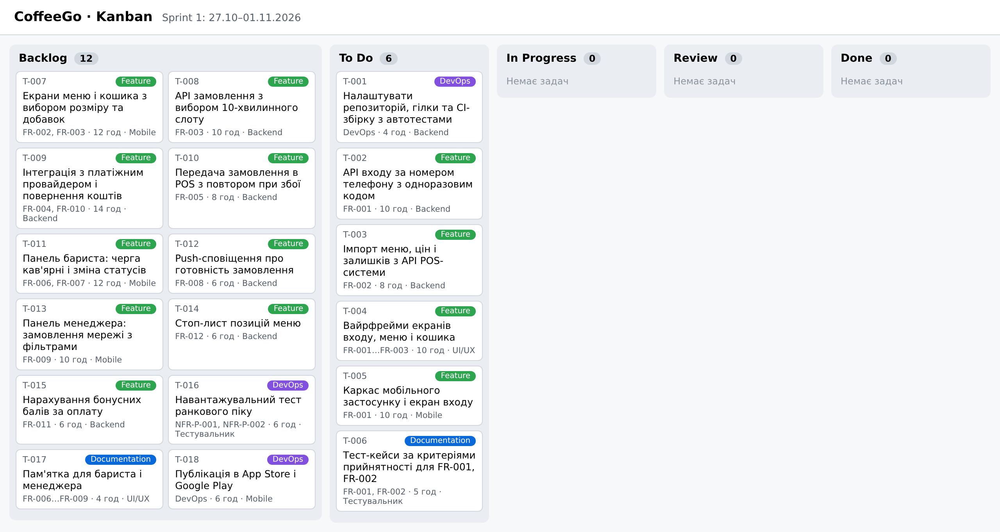

# Дошка задач і Sprint Plan

Дошка: GitHub Projects, колонки **Backlog → To Do → In Progress → Review → Done**, 18 задач, мітки Feature / Documentation / DevOps / Bug.

## Sprint 1 (27.10–01.11.2026)

**Sprint Goal:** клієнт може увійти в застосунок за номером телефону, а сервер отримує актуальне меню кав'ярні з POS-системи.

| ID | Задача | Оцінка, год | Виконавець | Вимога |
|---|---|---|---|---|
| T-001 | Налаштувати репозиторій, гілки та CI-збірку з автотестами | 4 | Backend-розробник | DevOps |
| T-002 | API входу за номером телефону з одноразовим кодом | 10 | Backend-розробник | FR-001 |
| T-003 | Імпорт меню, цін і залишків з API POS-системи | 8 | Backend-розробник | FR-002 |
| T-004 | Вайрфрейми екранів входу, меню і кошика | 10 | UI/UX дизайнер | FR-001…FR-003 |
| T-005 | Каркас мобільного застосунку і екран входу | 10 | Frontend/Mobile-розробник | FR-001 |
| T-006 | Тест-кейси за критеріями прийнятності для FR-001, FR-002 | 5 | Тестувальник | FR-001, FR-002 |
| **Разом** | | **47** | | |

## Definition of Done спринту

1. Усі задачі спринту мають статус Done на дошці.
2. Код пройшов Code Review і злитий в основну гілку без конфліктів.
3. CI-збірка і всі автотести проходять успішно.
4. Функціонал перевірено за критеріями прийнятності FR-001, FR-002.
5. Немає відкритих дефектів Bug з пріоритетом Critical або High.
6. Інкремент розгорнуто на staging і показано замовнику.
7. README.md та OpenAPI-специфікацію оновлено.
